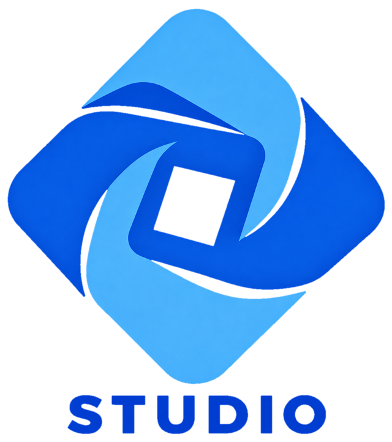

<p align="center">
  
</p>

<p align="center">A Roblox Studio launcher for Linux, built around <a href="https://github.com/microlift/rosemary">Rosemary</a>.</p>

> [!WARNING]
> ## This is a personal project
>
> Ginrose Studio was made for one computer (Fedora, Hyprland, an NVIDIA card)
> and is only tested there. It may well not work on yours: other distros,
> desktops and GPUs have not been tried. Roblox Studio on Rosemary is newer
> than the Roblox client and less tested: logging in, opening places, Team
> Create and dragging models work, but some tools may misbehave. It is shared
> as it is, with no promise of support or fixes. If it breaks for you, an issue
> is welcome, but it may not get an answer soon, or at all.

This repository holds Ginrose Studio's installer and its official Flatpak
releases. Its source code is part of
[nunreasonable/ginrose](https://github.com/nunreasonable/ginrose#ginrose-studio),
which builds both Ginrose and Ginrose Studio.

Ginrose Studio runs the official macOS Roblox Studio on Linux through Rosemary,
a macOS compatibility layer. It downloads Studio straight from Roblox and keeps
it up to date. Unlike Ginrose, it is a development tool and leaves you in
charge:

- no checks on what runs: Studio is not checked against Roblox's signature, and
  **Repair** downloads it again when you want clean files;
- any FastFlag, not only Roblox's allowlist;
- any environment variable for Rosemary, extra launch arguments, and a Rosemary
  binary of your choice;
- buttons for Studio's plugins folder and Documents;
- "Edit in Studio" on the website and Studio's browser login come back to the
  running Studio.

## Install

You need [Flatpak](https://flatpak.org/setup/) and an x86_64 computer. Then:

```sh
curl -fsSL https://raw.githubusercontent.com/nunreasonable/ginrose-studio/main/install.sh | sh
```

The script downloads the latest release, checks it against `SHA256SUMS`,
installs the GNOME 51 runtime from Flathub and installs Ginrose Studio for your
user. Nothing needs root. The setup downloads Roblox Studio (about 600 MB) on
the first run. Ginrose and Ginrose Studio can be installed side by side; each
keeps its own settings and files.

### By hand

Download `me.daeese.apps.ginrose.studio.flatpak` and `SHA256SUMS` from the
[latest release](https://github.com/nunreasonable/ginrose-studio/releases/latest), then:

```sh
sha256sum -c --ignore-missing SHA256SUMS
flatpak remote-add --user --if-not-exists flathub https://dl.flathub.org/repo/flathub.flatpakrepo
flatpak install --user flathub org.gnome.Platform//51
flatpak install --user me.daeese.apps.ginrose.studio.flatpak
```

To have it open Studio's links when another app already does:

```sh
xdg-mime default me.daeese.apps.ginrose.studio.editor.desktop x-scheme-handler/roblox-studio x-scheme-handler/roblox-studio-auth
```

### Native packages

The release also has the same build as a distribution package, for those who
would rather not use Flatpak. They need glibc 2.39, GTK 4.14 and libadwaita
1.6 or newer: Debian 13, Ubuntu 25.04, Fedora 42 or later, openSUSE Tumbleweed
and Arch have them. From the [latest release](https://github.com/nunreasonable/ginrose-studio/releases/latest):

```sh
sudo pacman -U ginrose-studio-bin-*-x86_64.pkg.tar.zst       # Arch
sudo apt install ./ginrose-studio_*_amd64.deb                # Debian, Ubuntu
sudo dnf install ./ginrose-studio-*.x86_64.rpm               # Fedora
sudo zypper install ./ginrose-studio-*.x86_64.rpm            # openSUSE
```

Rosemary is not part of these packages: Ginrose Studio uses a `rosemary` on
your `PATH` (the AUR's `rosemary`, for example) or downloads one in its setup,
which then needs SDL 3.4 and OpenAL, and Studio's login WebKitGTK 6.0. NixOS
and Gentoo build from source: see [packaging](https://github.com/nunreasonable/ginrose/tree/main/packaging) in
nunreasonable/ginrose.

### Update and uninstall

Run the install command again to update. To remove Ginrose Studio:

```sh
flatpak uninstall --user me.daeese.apps.ginrose.studio
```

Its data stays in `~/.var/app/me.daeese.apps.ginrose.studio` until you delete
that folder.

## Credits

- [Rosemary](https://github.com/microlift/rosemary) does the hard part:
  running macOS programs on Linux.
- [Nutmeg](https://github.com/frolleks/nutmeg) showed how a Rosemary
  bootstrapper fits together.

## License

Ginrose Studio is free software under the GNU General Public License, version
3 or later, and so is this installer; see [LICENSE](LICENSE). The source is at
[nunreasonable/ginrose](https://github.com/nunreasonable/ginrose). The Flatpak
includes Ginrose's build of Rosemary, also GPL-3.0; its source is at
[nunreasonable/rosemary](https://github.com/nunreasonable/rosemary/tree/ginrose-0.3.3).

The name "Ginrose Studio", its logo and its application ID are not covered by
the license: a modified version has to go by its own name. See
[TRADEMARKS.md](https://github.com/nunreasonable/ginrose/blob/main/TRADEMARKS.md).
The releases here are the official builds.

Ginrose Studio is not affiliated with or endorsed by Roblox Corporation.
